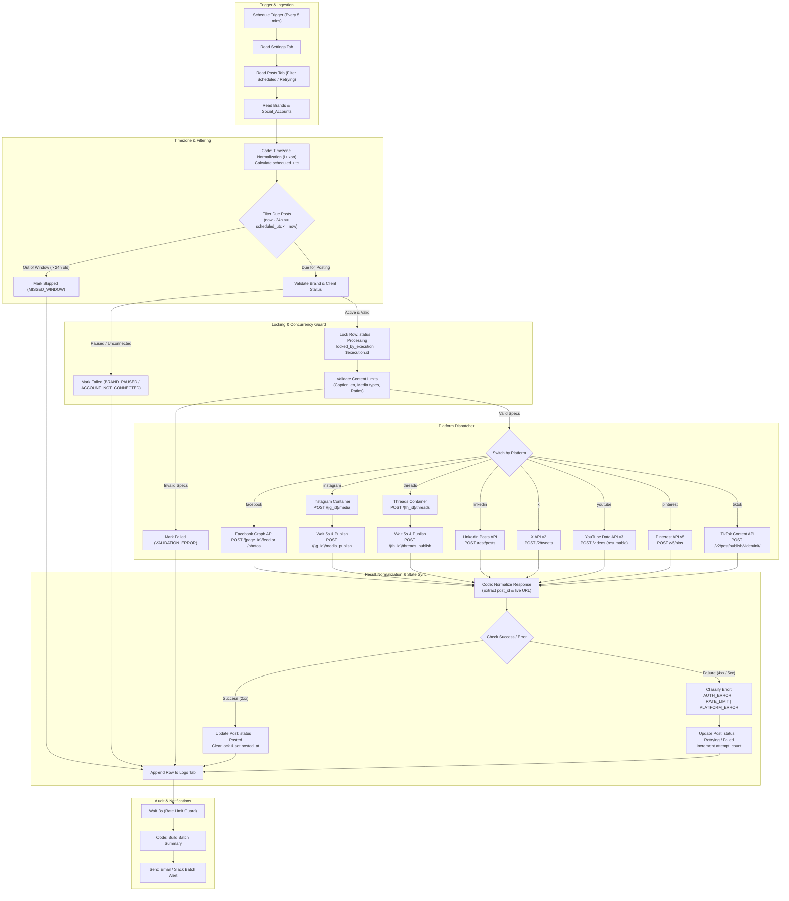

# Architecture & System Design: Multi-Brand Social Media Automation Hub

## 1. System Overview

The **Multi-Brand Social Media Automation Hub** is an enterprise-grade scheduling, multi-platform publishing, and audit logging engine built on **n8n** and backed by **Google Sheets**. It coordinates scheduled posts across multiple client organizations, sub-brands, and 8 social platforms (Facebook, Instagram, Meta Threads, LinkedIn, X / Twitter, YouTube, Pinterest, and TikTok) while enforcing strict idempotency, rate limiting, and time zone integrity.

---

## 2. Mermaid Architecture Diagram

---

## 3. Node-by-Node Explanation

### Phase 1: Trigger & Ingestion
1. **Schedule Trigger (`Schedule Trigger`)**:
   - Fires at a configurable recurrence (default: every 5 minutes).
2. **Read Settings (`Read Settings`)**:
   - Retrieves key-value operational controls from the `Settings` tab: `max_retries` (default: 3), `retry_delay_minutes` (default: 15), `poll_interval_minutes` (5), `missed_window_hours` (24), `alert_email`, and `slack_webhook`.
3. **Read Posts (`Read Posts`)**:
   - Fetches rows where `status` is either `"Scheduled"` or `"Retrying"` (with `attempt_count < max_retries`).
4. **Read Brands & Accounts (`Read Brands`, `Read Social Accounts`)**:
   - Loads the active brand metadata and social media account mappings into context for foreign key lookups.

### Phase 2: Time Zone Normalization & Eligibility
5. **Normalize Timezones (`Normalize Timezones`)**:
   - Implemented via Luxon `DateTime.fromFormat(date + ' ' + time, 'yyyy-MM-dd HH:mm', { zone: post_tz || brand_default_tz })`.
   - Validates the IANA identifier using `IANAZone.isValidZone`. If invalid, flags the post with `INVALID_TIMEZONE`.
   - Calculates `scheduled_utc` formatted in ISO 8601 (`yyyy-MM-dd'T'HH:mm:ss'Z'`).
6. **Filter Due Posts (`Filter Due Posts`)**:
   - Rejects posts in the future (`scheduled_utc > now`).
   - If `scheduled_utc < now - missed_window_hours (24h)`, updates status directly to `"Skipped"` with error `"MISSED_WINDOW"`.

### Phase 3: Brand/Client Validation & Locking
7. **Join & Validate Accounts (`Join & Validate Account`)**:
   - Verifies `Clients.status === "Active"`, `Brands.status === "Active"`, and `Social_Accounts.connection_status === "Connected"`.
   - If paused or missing, updates status to `"Failed"` with specific codes (`CLIENT_PAUSED`, `BRAND_PAUSED`, `ACCOUNT_NOT_CONNECTED`, `ACCOUNT_EXPIRED`).
8. **Lock Post Row (`Lock Post Row`)**:
   - Writes `status = "Processing"` and `locked_by_execution = {{$execution.id}}` to the Google Sheet using matching column `post_id`.
   - Any concurrent execution encountering a locked row skips it, eliminating duplicate publishing.

### Phase 4: Platform Content Validation
9. **Validate Platform Requirements (`Validate Content Limits`)**:
   - **X (Twitter)**: Text limit 280 characters.
   - **LinkedIn**: Text limit 3,000 characters.
   - **Instagram Business**: Requires media (`media_url` cannot be empty). Caption limit 2,200 characters.
   - **Meta Threads**: Text limit 500 characters.
   - **YouTube**: Requires media type `video` and a non-empty `post_title`.
   - **Pinterest**: Requires `board_id` in `social_media_id` and image URL.
   - On mismatch, marks `"Failed"` with `VALIDATION_ERROR: <reason>`.

### Phase 5: Multi-Platform Publishing Switch
10. **Platform Switch (`Platform Switch`)**:
    - Directs execution payload to platform-specific HTTP request nodes with n8n Credentials.
    - **Facebook (`Publish to Facebook`)**:
      - For status updates: `POST https://graph.facebook.com/v20.0/{page-id}/feed`
      - For images: `POST https://graph.facebook.com/v20.0/{page-id}/photos` with `url` and `caption`.
    - **Instagram Business (`IG Create Container` + `IG Publish Container`)**:
      - Step 1: `POST https://graph.facebook.com/v20.0/{ig-user-id}/media` with `image_url` / `video_url` and `caption`.
      - Wait 5 seconds for Meta media transcoding.
      - Step 2: `POST https://graph.facebook.com/v20.0/{ig-user-id}/media_publish` with `creation_id`.
    - **Threads (`Threads Create Container` + `Threads Publish Container`)**:
      - Step 1: `POST https://graph.threads.net/v1.0/{threads-user-id}/threads` with `media_type` and `text`.
      - Step 2: `POST https://graph.threads.net/v1.0/{threads-user-id}/threads_publish` with `creation_id`.
    - **LinkedIn (`Publish to LinkedIn`)**:
      - `POST https://api.linkedin.com/rest/posts` with `author` URN, `commentary`, and `visibility: "PUBLIC"`.
    - **X (`Publish to X / Twitter`)**:
      - `POST https://api.twitter.com/2/tweets` with `{"text": caption}`.
    - **YouTube (`Publish to YouTube`)**:
      - `POST https://www.googleapis.com/upload/youtube/v3/videos?part=snippet,status` with `snippet.title` and `snippet.description`.
    - **Pinterest (`Publish to Pinterest`)**:
      - `POST https://api.pinterest.com/v5/pins` with `board_id`, `media_source`, `title`, and `description`.
    - **TikTok (`Publish to TikTok`)**:
      - `POST https://open.tiktokapis.com/v2/post/publish/video/init/` with video URL and caption settings.

### Phase 6: Response Normalization, Error Classification & State Sync
11. **Normalize Response (`Normalize Response`)**:
    - Unified extraction of `platform_post_id` and permalink `post_url`.
    - Detects HTTP response codes:
      - `200/201`: Success.
      - `401/190`: `AUTH_ERROR` (Triggers `Social_Accounts.connection_status = "Expired"`).
      - `429`: `RATE_LIMIT` (Eligible for retry).
      - `500/502/503/504`: `PLATFORM_ERROR` (Eligible for retry).
      - Others: `UNKNOWN` or `CLIENT_ERROR`.
12. **Update Posts Tab (`Update Post Success` / `Update Post Error`)**:
    - On success: `status = "Posted"`, `posted_at = now`, `platform_post_id`, `post_url`, clears `error_code` and `locked_by_execution`.
    - On failure: If retryable and `attempt_count < max_retries`, marks `status = "Retrying"`. If max retries reached or non-retryable, marks `status = "Failed"`.
13. **Append to Logs Tab (`Append Log Entry`)**:
    - Inserts full telemetry row: `log_id`, `timestamp_utc`, `execution_id`, `post_id`, `brand_name`, `platform`, `action`, `result`, `http_status`, and `error_message`.
14. **Loop Rate Limiting (`Rate Limit Wait`)**:
    - Implements a pause (default: 3 seconds) between each scheduled item to prevent IP and API quota choking.
15. **Notifications (`Build Batch Summary` & `Send Notifications`)**:
    - Aggregates results of the run into a markdown and HTML summary.
    - Sends an email alert via Gmail or posts to a Slack webhook if any posts failed or expired tokens were detected.

---

## 4. Auxiliary Workflows

### Error Workflow (`workflows/error_handler.json`)
- Triggered automatically if `main_scheduler.json` encounters an unhandled crash or syntax failure.
- Queries `Posts` where `locked_by_execution === {{$execution.id}}`.
- Unlocks the rows and resets their status to `"Retrying"` (or `"Failed"` if attempts exceeded).
- Records the crash details in the `Logs` sheet and sends an emergency administrator alert.

### Retry Workflow (`workflows/retry_failed.json`)
- Triggerable via manual button click or webhook `POST /webhook/retry-failed-posts`.
- Accepts an optional list of `post_ids` or defaults to retrying all posts marked `"Failed"` with retryable error codes (`RATE_LIMIT`, `PLATFORM_ERROR`, `TIMEOUT`).
- Resets eligible rows back to `status = "Scheduled"` and zeroes out error indicators.
